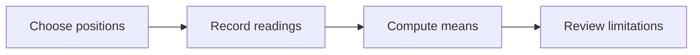

# A Tiny Study of Indoor Light

**Illustrative research paper · fictional data**

## Abstract

This small example explores how a workstation's distance from a window might
relate to measured illuminance. The measurements below are invented to
illustrate a reproducible Markdown document, not a scientific finding.

## Methods

We compare three imagined positions using the mean of repeated readings. For
readings $x_1, \ldots, x_n$, the sample mean is:

$$
\bar{x} = \frac{1}{n} \sum_{i=1}^{n} x_i
$$

| Position | Distance from window | Mean illuminance |
| :--- | ---: | ---: |
| A | 0.5 m | 610 lx |
| B | 1.5 m | 410 lx |
| C | 3.0 m | 220 lx |

```swift
func mean(_ readings: [Double]) -> Double {
    readings.reduce(0, +) / Double(readings.count)
}
```

## Study workflow



## Discussion

In this fictional example the mean decreases with distance. A real study would
need a calibrated sensor, repeated days, controlled weather and uncertainty
estimates before drawing conclusions.
