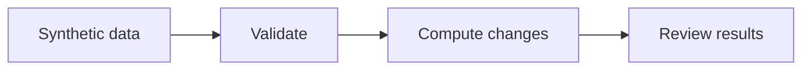

# Reproducible Analysis of a Small Dataset

**Illustrative methods paper · synthetic observations**

## Abstract

A transparent analysis records where data came from, how it was transformed,
and which results were produced. This fictional example demonstrates that
workflow with invented measurements.

## Dataset and calculation

For each observation, the change from baseline is $\Delta_i = y_i - b_i$.
The average change across $n$ observations is:

$$
\overline{\Delta} = \frac{1}{n}\sum_{i=1}^{n}(y_i-b_i)
$$

| Sample | Baseline | Follow-up | Change |
| :--- | ---: | ---: | ---: |
| S1 | 12 | 15 | +3 |
| S2 | 10 | 12 | +2 |
| S3 | 14 | 18 | +4 |

```swift
let changes = [3.0, 2.0, 4.0]
let average = changes.reduce(0, +) / Double(changes.count)
print(average) // 3.0
```

## Analysis pipeline



## Interpretation

The average change is **3 units** in this synthetic dataset. This is a worked
example, not evidence of an effect; real analysis requires appropriate data,
uncertainty estimates and a study design suited to the research question.
