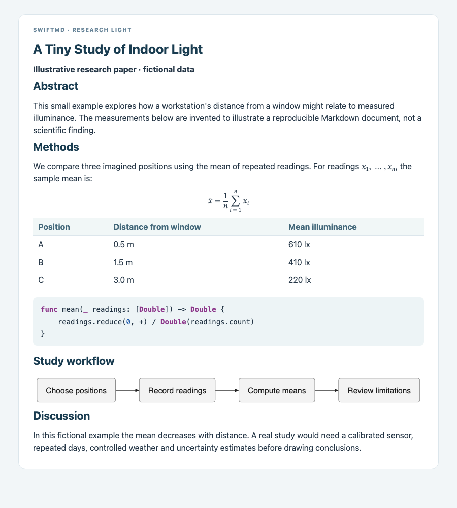
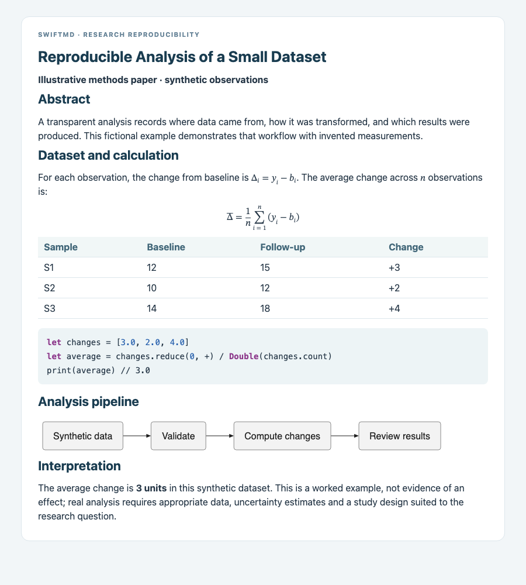
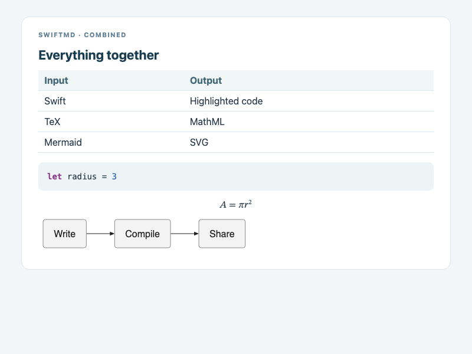
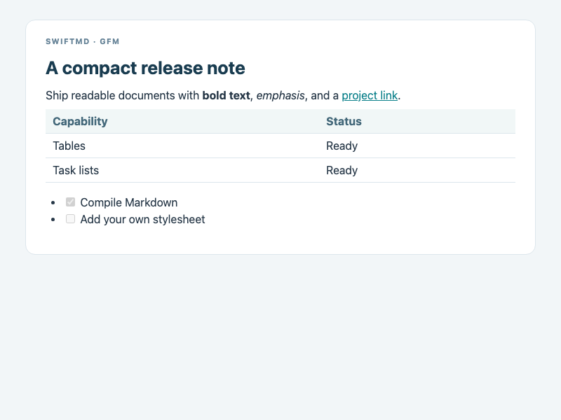
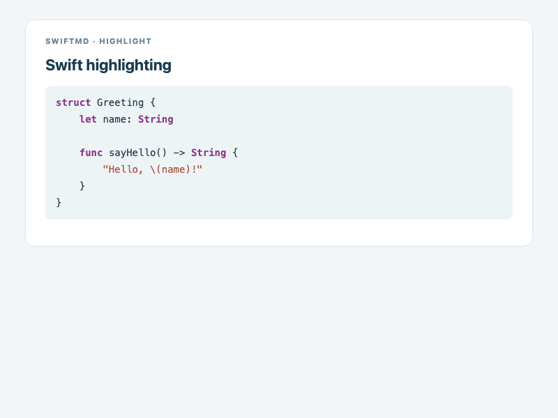
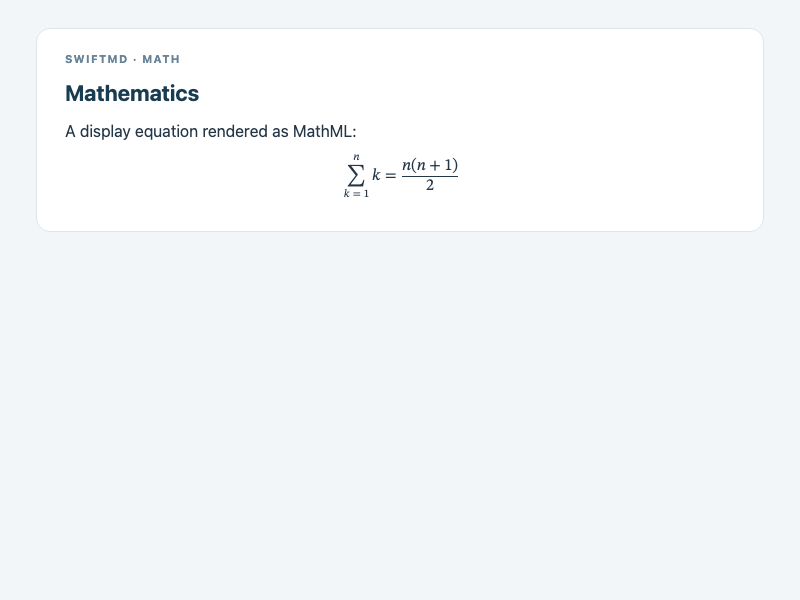
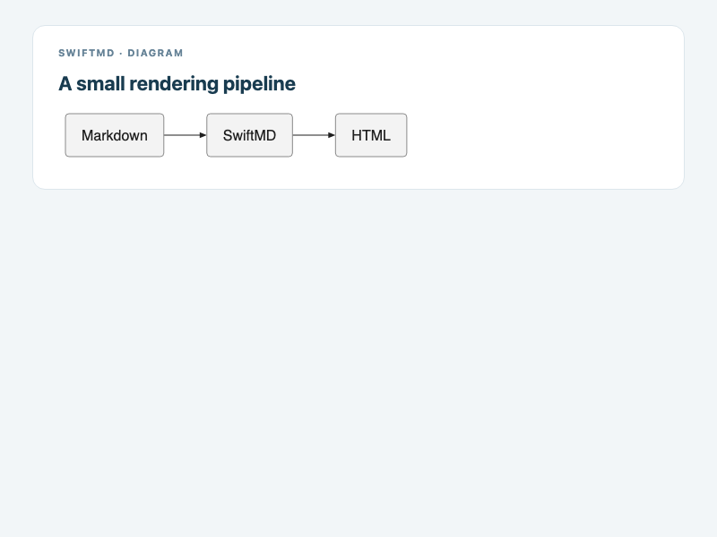

# SwiftMD example gallery

These independently written examples show actual SwiftMD CLI output. Each links
to its Markdown, generated HTML fragment and Chrome screenshot. The screenshots
use [preview.css](preview.css), which is not included in compiler output;
appearance depends on the browser, fonts and host stylesheet. JavaScript was
disabled while capturing these previews.

| Example | Markdown | HTML | Preview |
| --- | --- | --- | --- |
| GFM tables and tasks | [Source](Markdown/01-gfm.md) | [HTML](HTML/01-gfm.html) | [Screenshot](Images/01-gfm.png) |
| Swift highlighting | [Source](Markdown/02-highlight.md) | [HTML](HTML/02-highlight.html) | [Screenshot](Images/02-highlight.png) |
| Block mathematics | [Source](Markdown/03-math.md) | [HTML](HTML/03-math.html) | [Screenshot](Images/03-math.png) |
| Mermaid diagram | [Source](Markdown/04-diagram.md) | [HTML](HTML/04-diagram.html) | [Screenshot](Images/04-diagram.png) |
| Combined | [Source](Markdown/05-combined.md) | [HTML](HTML/05-combined.html) | [Screenshot](Images/05-combined.png) |
| Fictional light study | [Source](Markdown/06-research-light.md) | [HTML](HTML/06-research-light.html) | [Screenshot](Images/06-research-light.png) |
| Fictional data analysis | [Source](Markdown/07-research-reproducibility.md) | [HTML](HTML/07-research-reproducibility.html) | [Screenshot](Images/07-research-reproducibility.png) |

## Research-style documents

Both papers and their observations are invented to demonstrate rendering;
they are not scientific studies or evidence. Each source is used for both
output formats. The HTML uses the opt-in `--markdown-math` profile to render
inline and block formulas to MathML, plus Swift highlighting and Mermaid SVG.

| Example | Source | Actual HTML | Editable Word |
| --- | --- | --- | --- |
| A Tiny Study of Indoor Light | [Markdown](Markdown/06-research-light.md) | [HTML](HTML/06-research-light.html) | [DOCX](DOCX/06-research-light.docx) |
| Reproducible Analysis of a Small Dataset | [Markdown](Markdown/07-research-reproducibility.md) | [HTML](HTML/07-research-reproducibility.html) | [DOCX](DOCX/07-research-reproducibility.docx) |

The experimental DOCX exporter preserves mathematical markup as editable text
and Mermaid fences as labelled source. It does not create Office Math,
embedded diagrams or syntax-highlighted Word code. Layout and pagination are
chosen by the Word-compatible application, and may differ from the browser.

### Light study



### Data analysis



## Focused feature examples



### GFM tables and tasks



### Swift highlighting



### Block mathematics



### Mermaid diagram



From the repository root, after `npm ci --ignore-scripts --prefix Tools/NodeDependencies`:

```sh
swift build --package-path Tools/SwiftMDCLI
python3 Scripts/render-examples.py --binary Tools/SwiftMDCLI/.build/debug/swift-md \
  --node "$(command -v node)" --check
```

Omit `--check` to update the HTML. Add
`--chrome '/path/to/Google Chrome'` to recapture screenshots. Images can vary
with browser and fonts; inspect them visually after updating. The executable and
Node module paths must be trusted. The optional adapters are experimental.


## Regenerate and check the Word examples

The small example-only Swift package uses the local DOCX adapter. It does not
add a product or dependency to SwiftMD Core:

```sh
swift build --package-path Examples/DOCXGenerator
python3 Scripts/render-docx-examples.py \
  --binary Examples/DOCXGenerator/.build/debug/GalleryDOCX --check
```

Omit `--check` to regenerate the DOCX files. The check compares generated
bytes and independently validates ZIP CRCs, XML parts and relationships.
The HTML check above also covers both research papers with Markdown math
explicitly enabled. To recapture one screenshot without changing the others,
add `--only 06-research-light --chrome '/path/to/Google Chrome'` to the HTML
command and omit `--check`.
