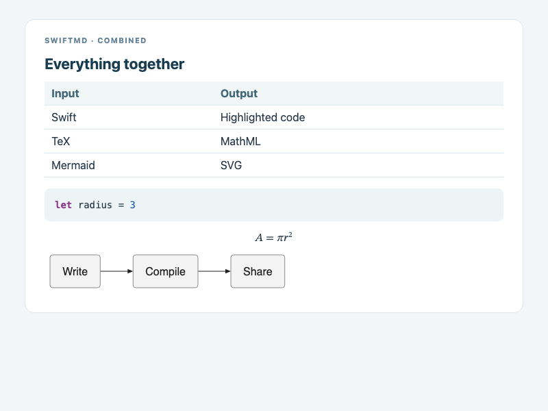

# SwiftMD

SwiftMD compiles Markdown to HTML using SwiftGFM, a Swift wrapper around the
pinned cmark-gfm C parser. The root SwiftPM product has no JavaScript runtime,
browser UI, Apple framework, or optional renderer dependency. With no block
renderers it returns the exact bytes produced by SwiftGFM for the configuration.

The opt-in `Adapters/SwiftMDBlocks` package adds structured HTML block processing,
Swift-Highlight, KaTeX-to-MathML and Pele-to-SVG. The last two use explicitly
configured local Node processes at compile time. The generated MathML and SVG
are embedded in the HTML; their display does not require client-side JavaScript.
These adapters and the CLI are experimental, not a security-reviewed release.

## Install the core library

```swift
.package(url: "https://github.com/ThorFuchs/Swift-MD.git", from: "0.1.0")
```

Add `.product(name: "SwiftMD", package: "Swift-MD")` to your target.
The root package depends only on SwiftGFM; the separate adapter mirror is not
yet published, so the optional adapters and CLI are built from a local checkout.

```swift
import SwiftMD
let result = try MarkdownCompiler().render("# Hello\n")
print(result.html)
```

## Supported extensions

| Feature | Input | Rendering | Output |
| --- | --- | --- | --- |
| GFM | Tables, task lists, autolinks and strikethrough | SwiftGFM / cmark-gfm | HTML |
| Syntax highlighting | A supported language code fence | Swift-Highlight | HTML with CSS classes |
| Block mathematics | A `math` code fence | KaTeX on Node | MathML |
| Diagrams | A `mermaid` code fence | Pele on Node | SVG |

KaTeX and Pele run at compile time; embedded MathML and SVG require no
client-side JavaScript. Highlighting needs a host stylesheet. See the
[example gallery](Examples/README.md) for Markdown, actual HTML and screenshots.



[DocC documentation](https://thorfuchs.github.io/Swift-MD/documentation/swiftmd/)
includes the core API, extension guide and security boundaries.

## Local CLI

```sh
(cd Tools/NodeDependencies && npm ci --ignore-scripts)
(cd Tools/SwiftMDCLI && swift build -j 4)
NODE="$(command -v node)"
ROOT="$(pwd)"
Tools/SwiftMDCLI/.build/debug/swift-md --document --highlight \
  --katex-node "$NODE" --katex-module "$ROOT/Tools/NodeDependencies/node_modules/katex" \
  --pele-node "$NODE" --pele-module "$ROOT/Tools/NodeDependencies/node_modules/pele/dist/pele.js" \
  --svg-prefix my-page input.md --output output.html
```

Input is a UTF-8 file or stdin; output is a fragment on stdout by default.
`--document` adds a minimal document. Use `--strict` to fail on any block
issue before writing output. `--version` prints the backend identity.
Highlighting supplies classes but no CSS. The page-unique `--svg-prefix`
prevents collisions between separately rendered documents placed on one page.
Both executable and module paths must be trusted absolute paths. Node 26.5.0 was
used in the present local test; the lockfile requires Node >=22.12.0 for its
`commander` dependency. See [adapter documentation](Adapters/SwiftMDBlocks/README.md).

`math` and `mermaid` code fences opt into the respective renderer. `$$` block
syntax and inline math are not implemented: SwiftGFM parses those as ordinary
Markdown, so adding them correctly requires parser integration. `--unsafe-html`
explicitly enables raw HTML and unsafe links; neither it nor ordinary rendering
is a sanitizer. Extension renderers and host CSS are separate trust boundaries.
The Node adapters themselves enforce no hard process time, memory or live
output limit. Linux deployments can opt into the constrained worker described
in the adapter documentation; it is not a sandbox.

For bounded stdin, stdout and stderr as well as a process-group deadline, see
the optional [Linux supervised worker](Documentation/PROCESS_ISOLATION.md).
It does not provide cgroup, filesystem or network isolation.

Run `Scripts/test-all.sh` after installing the pinned npm packages and setting
`SWIFTMD_CMARK_REFERENCE` to the independently built pinned C executable; the
integration gate fails if it or a real renderer is missing. The optional
`node Scripts/test-browser.mjs` verifies a generated page in local Chromium with
page JavaScript disabled. More precise
coverage, known limitations, dependency provenance and release blockers are in
[status](Documentation/STATUS.md) and [third-party notices](ThirdPartyLicenses/README.md).

The isolated version-based distribution gate is described in
[release preparation](Documentation/RELEASE_PREPARATION.md). It creates only
temporary local test tags and a local test mirror; it publishes nothing.
See the [SVG, process and license review](Documentation/SECURITY_LICENSE_REVIEW.md)
for the current evidence and remaining release boundaries.
