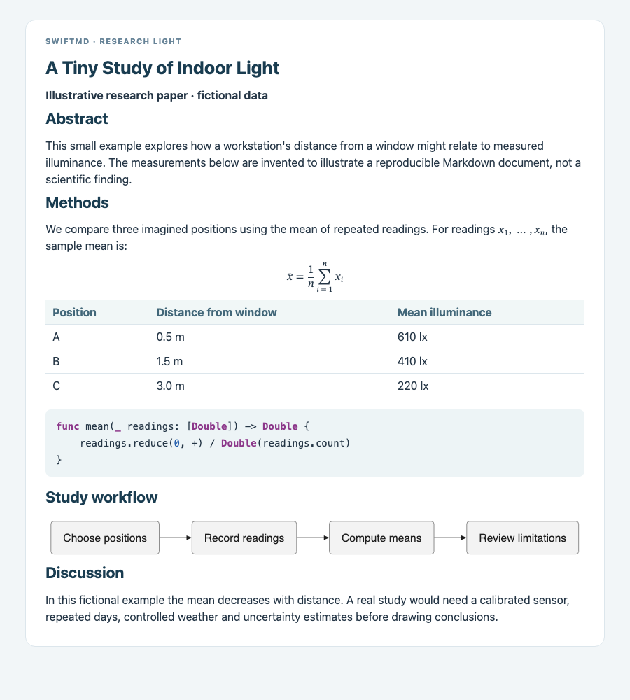
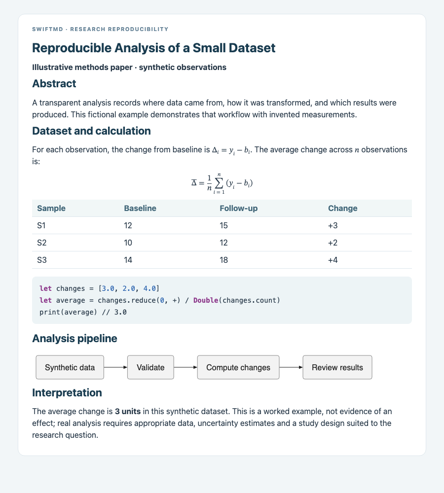

# SwiftMD

SwiftMD compiles Markdown to HTML using SwiftGFM, a Swift wrapper around the
pinned cmark-gfm C parser. The root SwiftPM product has no JavaScript runtime,
browser UI, Apple framework, or optional renderer dependency. With no block
renderers it returns the exact bytes produced by SwiftGFM for the configuration.

The opt-in adapter package adds structured HTML block processing,
Swift-Highlight, KaTeX-to-MathML and Pele-to-SVG. The bundled integration uses
JavaScriptCore on Apple platforms and an explicitly configured local Node
process on Linux. The generated MathML and SVG are embedded in the HTML; their
display does not require client-side JavaScript. See the security contract
before using the adapters with untrusted input.

The optional adapter package uses SwiftHTML 0.1.1 and its fixture-free
SwiftSoup 2.14.4 backend. SwiftMD Core and the generated adapters are separate
packages; see the [releases page](https://github.com/ThorFuchs/Swift-MD/releases)
for published versions.

## Install the core library

```swift
.package(url: "https://github.com/ThorFuchs/Swift-MD.git", from: "1.1.0")
```

Add `.product(name: "SwiftMD", package: "Swift-MD")` to your target.
The root package depends only on SwiftGFM. The optional adapter mirror is a
separate generated distribution from this source repository.

```swift
import SwiftMD
let result = try MarkdownCompiler().render("# Hello\n")
print(result.html)
```

## Compile with all bundled renderers

Add the generated adapter mirror to the package dependencies:

```swift
.package(url: "https://github.com/ThorFuchs/Swift-MD-Adapters.git", from: "1.2.0")
```

Add `.product(name: "SwiftMDBundled", package: "Swift-MD-Adapters")` to the
target dependencies. Then render Markdown containing Swift, `math` and
`mermaid` fences in one call:

```swift
import SwiftMDBundled

let result = try SwiftMDIntegrated.render(
    markdown,
    svgPrefix: "unique-page-id",
    nodeExecutable: "/trusted/absolute/path/to/node", // Linux; omit on Apple
    recognizeMath: true // opt in to inline and display Markdown math
)
print(result.html)
for diagnostic in result.diagnostics { print(diagnostic.message) }
```

The prefix must be distinct for each separately compiled fragment displayed on
the same page. The API returns diagnostics on block failures. The bundled
scripts and their notices are SwiftPM resources; Linux still requires Node.

## Supported extensions

| Feature | Input | Rendering | Output |
| --- | --- | --- | --- |
| GFM | Tables, task lists, autolinks and strikethrough | SwiftGFM / cmark-gfm | HTML |
| Syntax highlighting | A supported language code fence | Swift-Highlight | HTML with CSS classes |
| Markdown mathematics | `$...$` inline and `$$` delimiter lines, opt-in | KaTeX on JavaScriptCore or Node | MathML |
| Block mathematics | A `math` code fence | KaTeX on JavaScriptCore or Node | MathML |
| Diagrams | A `mermaid` code fence | Pele on JavaScriptCore or Node | SVG |

KaTeX and Pele run at compile time; embedded MathML and SVG require no
client-side JavaScript. Highlighting needs a host stylesheet.

## Example gallery

These independently written, fictional research papers combine GFM tables,
inline and display equations, Swift code and Mermaid diagrams. The screenshots
show the actual HTML with the gallery's own stylesheet and page JavaScript
disabled. The corresponding experimental DOCX files contain editable text;
math and Mermaid are retained as source, not Word equations or diagrams.

| A Tiny Study of Indoor Light | Reproducible Analysis of a Small Dataset |
| :---: | :---: |
| [](Examples/Markdown/06-research-light.md) | [](Examples/Markdown/07-research-reproducibility.md) |
| [Markdown](Examples/Markdown/06-research-light.md) · [HTML](Examples/HTML/06-research-light.html) · [Word](Examples/DOCX/06-research-light.docx) | [Markdown](Examples/Markdown/07-research-reproducibility.md) · [HTML](Examples/HTML/07-research-reproducibility.html) · [Word](Examples/DOCX/07-research-reproducibility.docx) |

See the [complete gallery](Examples/README.md) for additional focused examples,
regeneration instructions and the limits of each output format.

[DocC documentation](https://thorfuchs.github.io/Swift-MD/documentation/swiftmd/)
includes the core API, extension guide and security boundaries.

## Experimental DOCX projection

The source checkout includes an [experimental DOCX adapter](Adapters/SwiftMDDOCX/README.md)
that projects the SwiftGFM AST into editable WordprocessingML. Add the
`SwiftMDDOCX` product from the adapter package; its documented fallbacks and
errors apply.

## Local CLI

```sh
(cd Tools/NodeDependencies && npm ci --ignore-scripts)
(cd Tools/SwiftMDCLI && swift build -j 4)
NODE="$(command -v node)"
ROOT="$(pwd)"
Tools/SwiftMDCLI/.build/debug/swift-md --document --highlight \
  --katex-node "$NODE" --katex-module "$ROOT/Tools/NodeDependencies/node_modules/katex" \
  --pele-node "$NODE" --pele-module "$ROOT/Tools/NodeDependencies/node_modules/pele/dist/pele.js" \
  --svg-prefix my-page input.md --output output.html
```

Input is a UTF-8 file or stdin; output is a fragment on stdout by default.
`--document` adds a minimal document. Use `--strict` to fail on any block
issue before writing output. `--version` prints the backend identity.
Highlighting supplies classes but no CSS. The page-unique `--svg-prefix`
prevents collisions between separately rendered documents placed on one page.
Both executable and module paths must be trusted absolute paths. Node 26.5.0 was
used in the present local test; the lockfile requires Node >=22.12.0 for its
`commander` dependency. See [adapter documentation](Adapters/SwiftMDBlocks/README.md).

Pass `--markdown-math` alongside
the KaTeX options to recognize `$...$` and `$$...$$`; it is disabled by
default, including when KaTeX is configured for `math` fences. The equivalent
Swift API option is `recognizeMath: true`. See the [math profile](Documentation/INTEGRATED_RENDERING.md)
for syntax limitations and error handling. `--unsafe-html`
explicitly enables raw HTML and unsafe links; neither it nor ordinary rendering
is a sanitizer. Extension renderers and host CSS are separate trust boundaries.
The Node adapters themselves enforce no hard process time, memory or live
output limit. Linux deployments can opt into the constrained worker described
in the adapter documentation; it is not a sandbox.

For bounded stdin, stdout and stderr as well as a process-group deadline, see
the optional [Linux supervised worker](Documentation/PROCESS_ISOLATION.md).
It does not provide cgroup, filesystem or network isolation.

Run `Scripts/test-all.sh` after installing the pinned npm packages and setting
`SWIFTMD_CMARK_REFERENCE` to the independently built pinned C executable; the
integration gate fails if it or a real renderer is missing. The optional
`node Scripts/test-browser.mjs` verifies a generated page in local Chromium with
page JavaScript disabled. More precise
coverage, known limitations, dependency provenance and release blockers are in
[status](Documentation/STATUS.md) and [third-party notices](ThirdPartyLicenses/README.md).

The isolated version-based distribution gate is described in
[release preparation](Documentation/RELEASE_PREPARATION.md). It creates only
temporary local test tags and a local test mirror; it publishes nothing.
See the [SVG, process and license review](Documentation/SECURITY_LICENSE_REVIEW.md)
for the current evidence and remaining release boundaries.
The proposed [security and resource contract](Documentation/SECURITY_CONTRACT.md)
defines the deployment responsibilities for deployed renderers.
